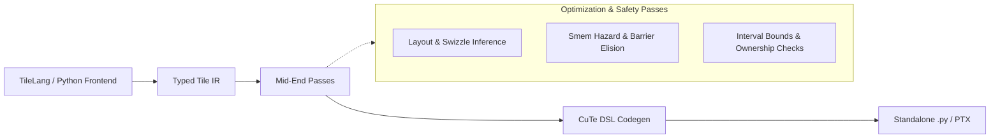

<div align="center">

# ⚡ Ntilang

**Write TileLang, compile directly to NVIDIA CuTe DSL.**

[](https://github.com/nya-a-cat/Ntilang/actions/workflows/ci.yml)
[](https://www.python.org/)
[](https://docs.nvidia.com/cutlass/latest/media/docs/pythonDSL/overview.html)
[](#benchmarks-on-nvidia-a100)
[](LICENSE)

[Overview](#overview) · [Benchmarks](#benchmarks-on-nvidia-a100) · [Features](#features) · [How It Works](#how-it-works) · [Setup](#setup) · [Usage](#usage) · [Examples](#examples)

</div>

---

## Overview

**Ntilang** is a drop-in [TileLang](https://github.com/tile-ai/tilelang) compiler that lowers GPU kernels directly to native **NVIDIA CuTe DSL** — no heavy C++/TVM stack required.

Switch your existing TileLang code in one line:

```diff
- import tilelang
+ import ntilang as tilelang
```

Or patch imports dynamically with `ntilang.patch_tilelang()`. Write high-level tiled kernels with multi-stage `cp.async` pipelines, shared-memory swizzling, and Tensor Core MMA, then run them immediately on PyTorch CUDA tensors — or export the generated CuTe Python source and ship it anywhere CuTe runs.

```python
import torch
import ntilang as tilelang
import ntilang.language as T


@tilelang.jit(out_idx=[-1], target="auto")
def matmul(m, n, k, bm=128, bn=128, bk=32, num_stages=3):
    @T.prim_func
    def gemm(
        A: T.Tensor((m, k), "float16"),
        B: T.Tensor((k, n), "float16"),
        C: T.Tensor((m, n), "float32"),
    ):
        with T.Kernel(T.ceildiv(m, bm), T.ceildiv(n, bn), threads=128) as (bx, by):
            A_shared = T.alloc_shared((bm, bk), "float16")
            B_shared = T.alloc_shared((bk, bn), "float16")
            C_local = T.alloc_fragment((bm, bn), "float32")
            T.use_swizzle(panel_size=8)
            T.clear(C_local)
            for ko in T.Pipelined(T.ceildiv(k, bk), num_stages=num_stages):
                T.copy(A[bx * bm, ko * bk], A_shared)
                T.copy(B[ko * bk, by * bn], B_shared)
                T.gemm(A_shared, B_shared, C_local)
            T.copy(C_local, C[bx * bm, by * bn])

    return gemm


a = torch.randn(4096, 4096, device="cuda", dtype=torch.float16)
b = torch.randn(4096, 4096, device="cuda", dtype=torch.float16)
kernel = matmul(4096, 4096, 4096)
c = kernel(a, b)              # ~210 TFLOPS on NVIDIA A100
kernel.save("gemm_cute.py")   # Export standalone CuTe DSL module
```

<details>
<summary><b>Click to inspect the real CuTe DSL generated for the kernel above</b></summary>

```python
import cutlass
import cutlass.cute as cute
import cutlass.utils as utils

@cute.kernel
def _nt_kernel(_b_A: cute.Tensor, _b_B: cute.Tensor, _b_C: cute.Tensor):
    _nt_tid, _, _ = cute.arch.thread_idx()
    _v_bx, _v_by, _ = cute.arch.block_idx()
    _nt_smem = utils.SmemAllocator()
    _nt_mma = cute.make_tiled_mma(
        cute.nvgpu.warp.MmaF16BF16Op(cutlass.Float16, cutlass.Float32, (16, 8, 16)),
        cute.make_layout((2, 2, 1)),
    )
    # 3-stage swizzled shared memory + 128-bit cp.async + LdMatrix8x8x16bOp
    _b_A_shared = _nt_smem.allocate_tensor(
        cutlass.Float16,
        cute.make_composed_layout(
            cute.make_swizzle(2, 3, 3), 0, cute.make_layout((128, 32, 3), stride=(32, 1, 4096))
        ),
        byte_alignment=16,
    )
    # ... prologue cp.async prefetch, pipelined mainloop with cp_async_wait_group(1),
    #     LdMatrix S2R loads, warp-level cute.gemm, and epilogue writeback
```

Run `uv run --frozen python examples/matmul.py` to print the full generated module on any machine (no GPU required).

</details>

---

## Benchmarks on NVIDIA A100

Measured on **NVIDIA A100-SXM4-40GB** (`sm_80`) with `nvidia-cutlass-dsl==4.7.1`, `torch==2.14.1`, and `triton==3.8.0`. All listed Ntilang kernels compile with **0 register spills (`ld/st.local == 0`)** and **0 redundant consecutive barriers**.

| Kernel | Shape & Dtype | **Ntilang** | Triton | PyTorch | vs. Baseline | PTX Barriers |
| :--- | :--- | ---: | ---: | ---: | :--- | ---: |
| **FP16 GEMM** | `4096³` (`fp16→fp32`) | **210.4 TFLOPS** | 224.4 TFLOPS | 222.2 TFLOPS | **94.7% PyTorch** / 93.7% Triton | 2 |
| **Shared Transpose** | `4096×4096` (`fp32`) | **1,248.3 GB/s** | 1,260.3 GB/s | 580.0 GB/s | **2.15× PyTorch** / 99.0% Triton | 1 |
| **Row Cumsum** | `32768×256` (`fp32`) | **1,170.3 GB/s** | 1,170.3 GB/s | 840.2 GB/s | **1.39× PyTorch** / **100% Triton** | 2 |
| **Row Softmax** | `16384×512` (`fp32`) | **1,110.8 GB/s** | 1,170.3 GB/s | 1,149.8 GB/s | **94.9% Triton** | 6 |
| **Vector Add** | `16M` (`fp32`) | **1,244.4 GB/s** | 1,268.4 GB/s | 1,293.5 GB/s | **98.1% Triton** | 0 |
| **RMSNorm** | `4096×1024` (`fp32`) | **728.3 GB/s** | — | 303.4 GB/s *(eager)* | **2.40× PyTorch Eager** | 3 |

> **Also verified on A100 (`61/61` GPU tests + `2,370/2,370` CPU tests passing):** FlashAttention-2 (causal & non-causal, matching `F.scaled_dot_product_attention`), LayerNorm, Fused GEMM + Bias + ReLU, dynamic shapes (`SymInt`), global atomics (`T.atomic_add` / `T.atomic_max`), and `@tilelang.autotune`.

---

## Features

- **Drop-in TileLang compatibility** — Supports `@tilelang.jit(out_idx=..., target="auto")`, `ntilang.patch_tilelang()`, `T.Pipelined`, `T.use_swizzle`, `T.annotate_layout`, `T.gemm` (SS & RS), `T.clear`, `T.infinity`, and `T.alloc_local`.
- **Real GPU optimizations out of the box** — Automatic shared-memory swizzling (bank-conflict free), `LdMatrix` warp loads, 128-bit vectorized global copies, multi-stage `cp.async` pipelines (up to 163 KiB dynamic shared memory on A100), hazard-tracked barrier elimination, bounds-check elision, and 0-ULP warp-shuffle reductions & scans.
- **Readable, standalone CuTe output** — Every compiled kernel can be inspected via `.source` or exported with `.save()` into a clean CuTe Python module that compiles independently of Ntilang.
- **Dynamic shapes & autotuning** — Single-compile symbolic dimensions (`T.dynamic("m")` → `cute.sym_int32`) with zero recompilation across input shapes, plus `@tilelang.autotune` and inline PTX atomics (`T.atomic_add`, `T.atomic_max`).
- **Built-in PTX verification & CPU reference** — Inspect emitted PTX instructions (`mma.sync`, `ldmatrix`, `cp.async`, `bar.sync`, local spills) in CPU-only CI with `ntilang.ptx_verifier`, and verify math locally via the NumPy evaluator.

---

## How It Works

Ntilang compiles Python kernels through a clean, staged pipeline from frontend parsing to standalone CuTe DSL emission:



1. **Frontend (`@T.prim_func` / `@tilelang.jit`)**: Parses TileLang-style Python AST into a strongly typed Tile IR, resolving static tiles, layouts, and symbolic dimensions (`T.dynamic`).
2. **Mid-End Passes**: Infers bank-conflict-free swizzle layouts, tracks shared-memory read/write hazards to drop redundant `bar.sync` calls, and eliminates provably in-bounds branch guards.
3. **CuTe DSL Lowering**: Lowers loops and tile ops directly to CuTe primitives — 128-bit `CopyG2SOp` async pipelines, `LdMatrix8x8x16bOp`, `MmaF16BF16Op`, warp shuffles (`shfl.sync`), and `cute.sym_int32`.
4. **Verification**: `ntilang.ptx_verifier` compiles ahead-of-time via CuTe DSL to statically assert PTX instruction schedules and zero spilling without needing a GPU in CI.

---

## Setup

**1. Code generation & CPU verification (Linux / Windows, zero core dependencies):**

```sh
git clone https://github.com/nya-a-cat/Ntilang.git
cd Ntilang
uv sync --frozen
uv run --frozen python examples/matmul.py
```

**2. Native CUDA compilation & GPU execution (Linux, Python 3.12):**

```sh
uv sync --frozen --python 3.12 --extra cuda
```

Tested toolchain: `nvidia-cutlass-dsl==4.7.1` and `apache-tvm-ffi==0.1.11`. Native PTX compilation runs even on CPU-only Linux hosts; kernel execution requires a compatible NVIDIA GPU and CUDA PyTorch tensors.

---

## Usage

### 1. Drop-in replacement for existing TileLang code

```python
import ntilang

with ntilang.patch_tilelang():
    import tilelang
    import tilelang.language as T

    @tilelang.jit(out_idx=[-1], target="auto")
    def add(
        A: T.Tensor((1024,), "float32"),
        B: T.Tensor((1024,), "float32"),
        C: T.Tensor((1024,), "float32"),
    ):
        with T.Kernel(8, threads=128) as bx:
            for i in T.Parallel(128):
                C[bx * 128 + i] = A[bx * 128 + i] + B[bx * 128 + i]

# Runs directly on CUDA tensors; output C is allocated automatically via out_idx=[-1]
out = add(a_cuda, b_cuda)
```

### 2. Dynamic shapes without recompilation (`T.dynamic`)

```python
import ntilang as tilelang
import ntilang.language as T

M = T.dynamic("m")


@tilelang.jit(out_idx=[-1], target="auto")
def row_softmax(A: T.Tensor((M, 128), "float32"), B: T.Tensor((M, 128), "float32")):
    with T.Kernel(T.ceildiv(M, 4), threads=128) as bx:
        tile = T.alloc_fragment((4, 128), "float32")
        row_max = T.alloc_fragment((4,), "float32")
        row_sum = T.alloc_fragment((4,), "float32")
        for i, j in T.Parallel(4, 128):
            tile[i, j] = A[bx * 4 + i, j]
        T.reduce_max(tile, row_max, dim=1)
        for i, j in T.Parallel(4, 128):
            tile[i, j] = T.exp(tile[i, j] - row_max[i])
        T.reduce_sum(tile, row_sum, dim=1)
        for i, j in T.Parallel(4, 128):
            B[bx * 4 + i, j] = tile[i, j] / row_sum[i]


# Compiles ONCE via cute.sym_int32(), then runs for any row count
y1 = row_softmax(x_7x128)
y2 = row_softmax(x_131x128)
assert row_softmax.compile_count == 1
```

### 3. Autotuning & Staged Compiler API

```python
@tilelang.autotune(
    configs=[
        {"bm": 64, "bn": 64, "bk": 32, "num_stages": 2},
        {"bm": 128, "bn": 128, "bk": 32, "num_stages": 3},
    ],
)
@tilelang.jit(out_idx=[-1], target="auto")
def tuned_gemm(m, n, k, bm=64, bn=64, bk=32, num_stages=2):
    ...
```

For multi-frontend pipelines or offline compilation, use the staged `Compiler` API:

```python
compiler = ntilang.Compiler()
program = compiler.import_program(my_prim_func, frontend="tilelang")
lowered = compiler.lower(program, backend="cute", target="cuda:sm_80", out_idx=[-1])
lowered.emit(format="python").save("kernel_cute.py")
```

---

## Examples

| Category | Example | What it demonstrates |
| :--- | :--- | :--- |
| **LLM & Attention** | [FlashAttention-2](examples/flash_attention.py) | Causal & non-causal online softmax, RS-GEMM (`P × V`), multi-stage `cp.async` |
| **LLM & Norm** | [RMSNorm](examples/rmsnorm.py) / [LayerNorm](examples/layernorm.py) | Warp-shuffle reductions with fused affine scaling |
| **Tensor Core** | [Pipelined GEMM](examples/matmul.py) | Multi-stage `cp.async`, shared-memory swizzle, `LdMatrix`, L2 block swizzle |
| **Tensor Core** | [GEMM + Bias + ReLU](examples/matmul_relu.py) | Fused bias & activation directly in accumulator fragments |
| **Memory-Bound** | [Softmax](examples/softmax.py) / [Cumsum](examples/cumsum.py) | 0-ULP warp-shuffle reductions and O(1)-barrier prefix scans |
| **Memory-Bound** | [Tiled Transpose](examples/transpose.py) | Bank-conflict-free swizzled shared memory with 1 barrier |
| **Basics** | [Vector Add](examples/vector_add.py) / [Window Sum](examples/window_sum.py) / [Piecewise](examples/piecewise.py) | Guarded tail tiles, runtime bounds, and predicated branches |

---

## Roadmap

- [x] Drop-in TileLang compatibility (`import ntilang as tilelang`, `patch_tilelang()`, `out_idx`, `target="auto"`)
- [x] Ampere (`sm_80`) optimization stack: Swizzle, `LdMatrix`, 128-bit `cp.async` pipelines, warp shuffles, barrier & bounds elision
- [x] Single-compile dynamic shapes (`SymInt`), global atomics, `@tilelang.autotune`, and staged `Compiler` API
- [x] End-to-end LLM kernels on A100: FlashAttention-2, RMSNorm, LayerNorm, FP16 Tensor Core GEMM
- [ ] Register-direct `FullRow` RS-GEMM and intra-warp online softmax for high-throughput FlashAttention-2
- [ ] Vectorized GEMM epilogue stores (`STG.128`) and loop-invariant index hoisting for small/medium GEMMs
- [ ] Hopper (`sm_90`) TMA & WGMMA lowering

---

## Development & Testing

```sh
uv run --frozen ruff check python examples tests
uv run --frozen ruff format --check python examples tests
uv run --frozen pytest             # CPU & PTX compilation tests
uv run --frozen pytest -m gpu      # Full GPU correctness suite (requires CUDA GPU)
```

## Documentation

- [Language semantics](docs/semantics.md) · [Compiler architecture](docs/architecture.md) · [TileLang compatibility](docs/compatibility.md) · [Roadmap](ROADMAP.md)

## Acknowledgments

Ntilang's frontend syntax is compatible with and inspired by [TileLang](https://github.com/tile-ai/tilelang). Its backend targets [NVIDIA CuTe DSL](https://docs.nvidia.com/cutlass/latest/media/docs/pythonDSL/overview.html).

## License

[MIT](LICENSE)
